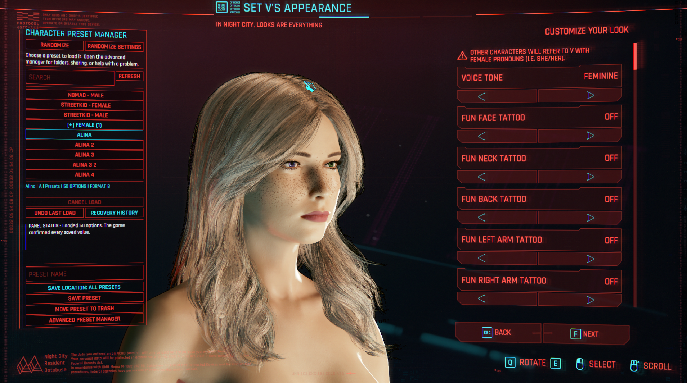
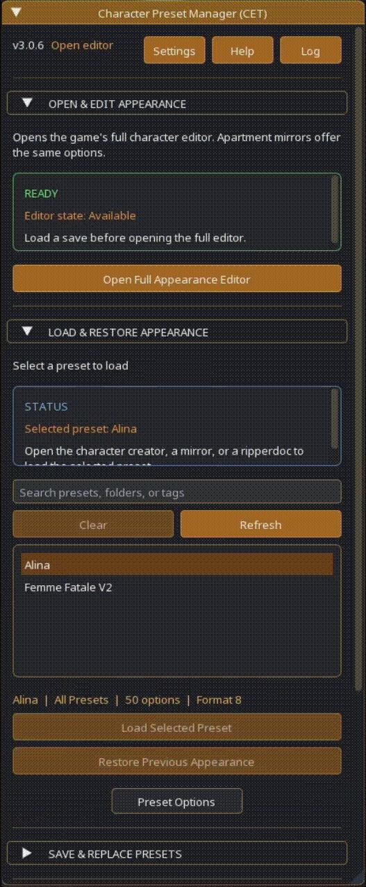
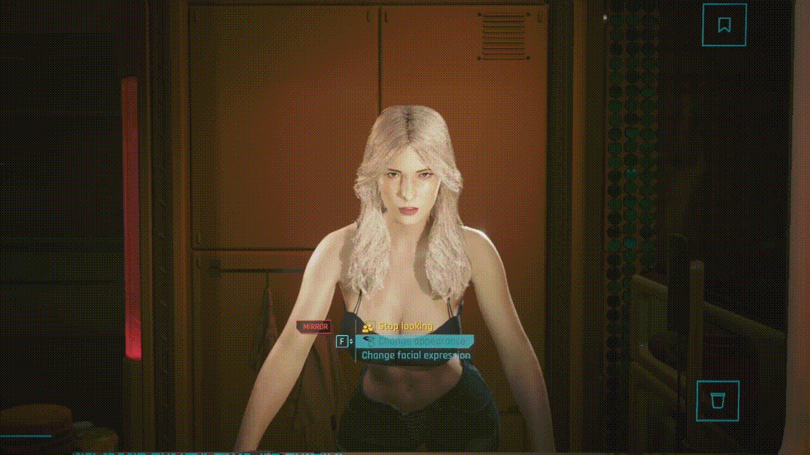

<h1 align="center">CHARACTER PRESET MANAGER</h1>

<p align="center"><strong>Your character. Your presets.</strong><br>
<em>Save, load, and share your looks. Supports ACU preset files.</em></p>

<p align="center">
  <a href="https://ko-fi.com/A3G129JCLF"></a>
  <a href="https://www.paypal.com/ncp/payment/7ZKG8YG6GCERC"></a>
</p>

<p align="center">If you enjoy my mods, you can support my work through Ko-fi or PayPal.</p>

<p align="center">
  <a href="https://www.nexusmods.com/cyberpunk2077/mods/31886"><strong>DOWNLOAD</strong></a>
  • <a href="https://discord.com/invite/mUGHmQxHG8"><strong>DISCORD</strong></a>
  • <a href="https://github.com/DKLYNTLY/Character-Preset-Manager-CET-"><strong>SOURCE CODE</strong></a>
</p>

<p align="center"><strong>Current version: 4.0.2</strong> · <a href="CHANGELOG.md">Changelog</a></p>

> [!IMPORTANT]
> Remove the **ACU mod**, but keep your **ACU presets**.

## About Character Preset Manager

Character Preset Manager is a successor to Appearance Change Unlocker (ACU).
It saves and loads your character's appearance, so you can switch between presets without recreating each look.

It reads older Character Preset Manager files and compatible ACU presets. Imports and older files follow the compatibility rules below. You can:

- Save and load vanilla, CC, and CCXL appearance choices.
- Open the character customization menu anywhere with a hotkey.
- Search by preset name, folder, or tag.
- Organize presets into folders, mark favorites, add notes, and rename or copy them.
- Share individual presets, folders, or selected groups.
- Recover deleted items from Trash.

---

<details>
<summary><strong>Showcase</strong></summary>

[](https://www.youtube.com/watch?v=zxrJ2Ryq-G8)

</details>

---

<details>
<summary><strong>Install and update</strong></summary>

### Requirements

Install these four frameworks:

- [Cyber Engine Tweaks](https://www.nexusmods.com/cyberpunk2077/mods/107) **1.38.0 or newer**
- [RED4ext](https://www.nexusmods.com/cyberpunk2077/mods/2380) **1.31.0 or newer**
- [redscript](https://www.nexusmods.com/cyberpunk2077/mods/1511) **0.5.32 or newer**
- [Codeware](https://www.nexusmods.com/cyberpunk2077/mods/7780) **1.21.1 or newer**

*Use versions that support your installed game. After a game update, check that the frameworks and this mod are compatible before using the editor.*

---

### First installation

1. Install the four required frameworks listed above.
2. Download Character Preset Manager from [Nexus Mods](https://www.nexusmods.com/cyberpunk2077/mods/31886).
3. For **manual installation**, extract the ZIP into your main `Cyberpunk 2077` folder. With a **mod manager**, install the archive normally.
4. Start the game and set up your CET overlay key if prompted.
5. Open character creation or an apartment mirror to use the Preset Manager.

---

### Update an existing installation

1. Close the game.
2. Back up the `Character Presets` and `Data` folders inside your current `Character Preset Manager (CET)` mod folder.
3. Remove these three folders from your game directory, including the native DLL in the last folder:

   ```text
   bin/x64/plugins/cyber_engine_tweaks/mods/Character Preset Manager (CET)
   r6/scripts/CharacterPresetManager
   red4ext/plugins/CharacterPresetManager
   ```

Do not rely on overwriting files alone. Old scripts can remain active.

4. Install the new version using the installation steps above, and update the required frameworks if needed.
5. Restore your backed-up `Character Presets` and `Data` folders to the mod folder.
6. Start the game.

</details>

---

<details>
<summary><strong>Compatibility and incompatibilities</strong></summary>

- EKT Custom Character Creator — Compatible
- All CCXL mods — Compatible
- Character Customization Anywhere — Incompatible
- Appearance Change Unlocker (ACU) — Incompatible

</details>

---

<details>
<summary><strong>Menus</strong></summary>

### Preset Manager

Appears in the character customization screen. From here, you can:

- Load a preset with one click.
- Save your appearance as a new preset or overwrite an existing one.
- Browse folders and favorites.
- Search by preset name, folder, or tag.
- Refresh the list after adding or changing preset files.
- Randomize your appearance and choose which categories can change.
- Undo the last preset load using one recovery snapshot.
- Move a preset to Trash.
- Open the Advanced Preset Manager.
- Check Panel Status for progress, warnings, and confirmations.



---

### Advanced Preset Manager

Open it with your CET overlay key, or select **Advanced Preset Manager** in the Preset Manager menu. From here, you can:

- Save, load, rename, and copy presets.
- Search presets and organize them with folders, favorites, notes, and tags.
- Move, export, or delete several presets at once.
- Import ACU presets and shared preset folders.
- Share individual presets, folders, or selected groups.
- Undo the last preset load.
- Move items to Trash, restore them, or delete them permanently.
- Check preset compatibility and review warnings under **Advanced Preset Options**.
- Open the full character customization menu.
- Randomize your appearance and choose which categories can change.
- Change preset sorting in **Settings** and view the Activity Log.

In CET, open **Load & Restore Appearance → Advanced Preset Options** to use
**Randomize Settings**. The **Randomize** button is under **Load & Restore Appearance**, below **Load Selected Preset**.



---

### Apartment mirrors

Apartment mirrors give you access to the full character customization menu.

**Gender cannot be changed mid-game.** Choose it when creating a new character.



</details>

---

<details>
<summary><strong>Manage presets: imports, folders, and sharing</strong></summary>

### Import ACU presets

Remove the **ACU mod** and keep its preset files. Old ACU text and JSON files, including **ACU 4.1.1 version-2 files** with a `// ACU-PRESET` header, convert in memory and use the shared format 9 loader.

Version-2 choices need a unique appearance name, morph name, or ordered switcher-name list. Indexed catalogs and unverifiable identities stay unresolved; those choices remain unchanged. Numeric-only ACU records use the choice currently at the saved index, so changed mods can change the mapped choice.

Check **Panel Status**, the **Activity Log**, and the visible appearance before confirming the editor. **Force Full Load** does not bypass version-2 identity checks or clear unrelated choices. Header-prefixed ACU version-3 files are rejected without applying them.

*Game version, body, and voice metadata do not prove compatibility. Loading never changes your character's body or voice.*

Imported ACU files stay read-only to protect their extra choice data. Correct unresolved choices after loading, then **save the checked appearance under a new name** to use CPM notes, tags, and favorites.

1. Remove the ACU mod, but keep its `.preset` files.
2. Put those presets in this folder inside your game directory. Create the folder if it no longer exists:

   ```text
   bin/x64/plugins/cyber_engine_tweaks/mods/AppearanceChangeUnlocker/character-presets
   ```

3. Start the game with Character Preset Manager installed.
4. Open the Advanced Preset Manager and look under **ACU Presets**. Select **Refresh** if a preset is missing.

Importing is automatic. Your original files stay unchanged, and imported copies keep their subfolders.

---

### Save format 9 and upgrade older CPM presets

New saves use readable **format 9** files named after the text you enter. Headers keep the name, source, creation and modification dates, notes, tags, favorite status, library folder, and body/voice metadata. Automatic recovery snapshots also use format 9.

Overwriting requires confirmation. Notes, tags, favorites, renaming, copies, and folders keep their normal save flow.

The six bundled **Default Presets** already use format 9 and include their body type. They do not need automatic conversion.

Identified CPM presets in formats 8 and below upgrade automatically. CPM finds them at startup and after **Refresh**, then uses the first matching-body editor catalog to convert their choices. A male preset waits for a male editor, and a female preset waits for a female editor.

Before replacing a file, CPM saves and verifies its original bytes under:

```text
Data/Recovery/Preset Upgrades/<batch>/<original preset path>.preset
```

The new format 9 file replaces the old file at its existing library path. Names, folders, notes, tags, favorites, and creation dates are kept; notes gain an automatic-upgrade message. Backups stay outside the library and are not deleted automatically.

If body evidence is missing or conflicting, open **Advanced Preset Manager → Load & Restore Appearance → Presets needing a body type** in CET. Choose **Male** or **Female** for the body that preset was saved for, independently of voice or its filename.

*Older records may contain only a choice number. Automatic upgrades use the current catalog at that number, so changed mods can change the mapped choice. Missing or ambiguous records stay unresolved in partial upgrades; files with no actionable choices remain unchanged.*

Selecting an old CPM preset loads it after a successful automatic upgrade in the current editor. Back, editor close, selection changes, and failures cancel that waiting load; opening an editor alone never applies an appearance.

Unmarked old text files keep the existing ACU-compatible path. Backup, path, and validation failures preserve the source and appear in the Activity Log; update the native DLL with the rest of the mod before testing upgrades.

CET sections start collapsed. Use **Advanced Preset Manager** for body assignments and upgrade progress; ordinary preset overwrites still require confirmation.

---

### Body filtering

**Settings → Preset Visibility → Filter by body** shows only known matches. Opposite-body and **Unknown** presets are hidden; **Show all presets** displays them, while loading still blocks known mismatches.

The selected preset shows **Male**, **Female**, or **Unknown** beside its format. Body metadata is separate from voice, and preset names do not determine it.

Old CPM presets needing a body choice still appear in the CET body-choice section when the normal list hides them. Choosing their source body labels the preset; it does not change your character.

Startup scans the library and checks missing body metadata. Press **Refresh** after adding files or to recheck missing body information from known breast or beard option identities. Conflicting or absent evidence stays Unknown; body detection itself updates only the library in memory. Automatic upgrades follow the separate backup and replacement steps above.

---

### Where files are stored

Your presets are stored here, inside the game folder:

```text
bin/x64/plugins/cyber_engine_tweaks/mods/Character Preset Manager (CET)/Character Presets
```

To share a preset, send its `.preset` file. To install one, place it in this folder or a subfolder, then select **Refresh** in the Advanced Preset Manager.

Ordinary format 9 and ACU reads and loads leave source files unchanged. Identified older CPM files are replaced only through automatic migration after a verified backup.

---

### Preset folders

Folders created in the Advanced Preset Manager organize your library without creating Windows folders. You can also make subfolders.

Copying a folder includes its presets and subfolders. **Remove Folder, Keep Presets** moves its contents to the parent folder.

---

### Folders added outside the game

If you put a folder inside `Character Presets`, it appears in the menu as **Imported**. Renaming or moving it in the menu does not rename or move the folder on your computer.

Choose **Remove Folder, Keep Presets** to move its presets into the main preset folder. The old folder is removed only when empty, so any other files stay safe.

Use regular folders, with no more than 12 levels of subfolders. Folder links that point somewhere else on your computer are not supported.

---

### Share a folder

1. Select a folder in **Create & Organize Folders**.
2. Open **Share & Import Folders** and choose **Export Selected Folder as a .cpmfolder File**.
3. Find the exported file in `Character Presets` and send it to someone else.

The file includes presets, subfolders, notes, tags, and favorites. Empty folders cannot be exported.

---

### Install a shared folder

1. Put the `.cpmfolder` file in `Character Presets`.
2. In the Advanced Preset Manager, open **Create & Organize Folders > Share & Import Folders**.
3. Select **Install .cpmfolder Files from Character Presets**.

To preview a file first, choose it under **Manage & Remove .cpmfolder Files**, then select **View Selected .cpmfolder Contents**.

Deleting the shared file afterward does not remove the presets you installed.

</details>

---

<details>
<summary><strong>Recovery and Trash</strong></summary>

### Original presets from automatic upgrades

Automatic-upgrade backups are separate from appearance history and Trash. They keep the original file bytes and subfolders under `Data/Recovery/Preset Upgrades`; CPM does not delete these backups automatically.

To restore one, close the game and copy the backed-up `.preset` over its matching path in **Character Presets**. Keep the backup copy afterward, since the restored old CPM file becomes eligible for automatic upgrade on the next run.

---

### Undo Last Load

Before loading a preset, CPM saves one snapshot of your current appearance to `Data/Recovery/LastAppearance.preset`. The next different snapshot replaces it; it is not a five-entry history.

Use **Undo Last Load** in either menu to restore that appearance. CPM saves one recovery file per changed snapshot.

Older files in `Data/Recovery/Appearance History` stay on disk. If the new undo file is absent, CPM can read the old newest entry for compatibility; it does not rotate or delete those older files.

---

### Trash

Presets and folders moved to Trash can be restored through **Delete & Restore Items** in the Advanced Preset Manager. If a name is already taken, the restored item gets “Copy” added to its name.

**Empty Trash Permanently** deletes the items in Trash. This cannot be undone.

</details>

---

<details>
<summary><strong>Common issues and bug reports</strong></summary>

### Redscript compilation failed

The error may name Character Preset Manager even when another mod is causing the problem. Check the log before deciding which mod to remove.

1. Open `r6/logs/redscript_rCURRENT.log` inside your game folder and look for errors.
2. Update or reinstall the four required frameworks listed under [Requirements](#requirements).
3. Check for outdated or duplicate mods, including Virtual Atelier.
4. Remove **cybercmd** if you have it installed.
5. Close the game and delete its `r6/cache` folder, then verify your game files through Steam, GOG, or Epic.
6. If compilation still fails, disable your redscript mods in small groups and test again to narrow down the cause.

You can also test with only the required frameworks installed, then enable your mods a few at a time. If you need help, share the redscript log and error message on [Discord](https://discord.com/invite/mUGHmQxHG8).

---

### Endless loading after changing your appearance

If the game gets stuck loading after you confirm your changes, your clothing or wardrobe outfit may be causing it.

Remove your clothing and select **No Outfit** in the wardrobe before opening the customization menu. You can put everything back on after you finish.

---

### Menu buttons don't respond or presets don't appear

Make sure all four required frameworks are installed and up to date, then fully restart the game.

Startup scans the library, and the first status message also prompts **Refresh**. Refresh an empty list and check **Preset Visibility**; body filtering hides Unknown and opposite-body presets.

---

### Downloaded presets don't appear

Check [Where files are stored](#where-files-are-stored) for preset installation steps. For ACU presets, follow [Import ACU presets](#import-acu-presets), then select **Refresh** in the Advanced Preset Manager.

---

### Deleted presets appear again

The original ACU preset may still be in your ACU presets folder. Automatic importing can bring it back after you delete the copy in Character Preset Manager.

Move the original out of the ACU presets folder, then delete the imported copy.

---

### An automatic upgrade is still pending

Open an editor with the preset's body type. If CPM cannot determine that body, use **Load & Restore Appearance → Presets needing a body type** in CET; the choice is saved for unchanged source bytes.

If the filesystem check times out, close the game and install the full update, including its **RED4ext DLL**. The Activity Log explains backup, permission, path, and journal errors. Correct the problem, then select **Refresh**.

Upgrade paths must use ordinary folders; folder links are rejected. CPM keeps the original when a backup cannot be verified, no actionable choices can be captured, or adding the upgrade note would exceed the notes limit.

Partial upgrades keep unresolved records and report a warning. Check the visible appearance and installed mods, because those unresolved choices remain unchanged during loading.

---

### Leftover hair, cyberware, or unconfirmed choices

The shared loader applies selectors before their dependent choices, without selector quiet waits. It checks identities before each write and keeps a quiet period before final verification.

Testing has shown leftovers in some loading sequences, including opposite-body presets. The cause is unproven; known body mismatches are blocked, and reopening the editor may not clear leftovers.

Character turning and new option-triggered poses pause while a preset loads. Breathing and idle animation continue. **Back** and editor close stay available, and turning resumes when loading ends; a missing motion hook does not block presets from loading. This does not prevent manual option edits or stop an animation that was already playing.

Check visible hair and cyberware as well as selected choices. An occasional hair-color verification warning may still appear; **Back** and editor close remain available during loading.

After the first verification pass, CPM rechecks uniquely identified choices whose values have not caught up. It reads fresh state every 50 ms and requires two matching observations before confirming a delayed value. These checks stay within the existing 1.25-second verification window and never apply a choice again. Loads that match on the first pass gain no extra wait; other loads can spend roughly another second checking.

The Activity Log separates **confirmed**, **confirmed after delay**, and **unconfirmed** choices. Missing or ambiguous choices still warn, and a confirmed value does not prove that an old mesh disappeared.

---

### Report a bug

Join [Discord](https://discord.com/invite/mUGHmQxHG8) and explain what happened and what you were doing. Include your latest `Activity.log` so I can check what went wrong.

Normal load summaries remain available in the Activity Log. Enable **Settings → Detailed appearance tracing** for per-choice logs, timing profiles, and full before/after snapshots. It defaults off and adds diagnostic work. **[LOAD PROFILE]** records load-only timing and work counters; nested CPU fields must not be added together, and waiting intervals do not prove mesh completion. Editor session numbers help track editor visits, but selected values and callbacks do not prove that a visible mesh was removed. Include screenshots and preset names when reporting leftovers.

To export the live option catalog, open a customization editor and choose **Log → Technical Details → Export Option Catalog** in the Advanced Preset Manager. Wait until any preset load has finished.

The text file is saved under `Data/Logs` as `Option Catalog YYYY-MM-DD HH-MM-SS-NNN.txt`. It records internal option names, labels, slots, occurrences, indexes, active/editable flags, and available choice identities. Duplicate choices keep their order; fields the game does not expose are marked unavailable.

I read only customization fields for this export; player and save names are not collected. Absolute paths in field values are redacted. The capture does not change options or preset files, and it adds no background polling. A large catalog may cause a short pause when you click the button.

The diagnostic export has no fixed option-count, choice-count, identity-length, or output-size limits. Include the exported file when reporting missing or reordered choices.

Include the **RED4ext log** when a report concerns ACU imports, folder watching, or opening CET. If it says the native file service stopped after an unexpected error, fully restart the game.

Select **Log** at the top of the Advanced Preset Manager to read or copy it. You can also find the file inside your game folder:

```text
bin/x64/plugins/cyber_engine_tweaks/mods/Character Preset Manager (CET)/Data/Logs/Activity.log
```

---

### Session caches and file limits

CPM reuses unchanged body checks and ACU conversions during the session. Numeric ACU conversions also check the relevant live catalog before reuse; restarting the game clears these caches.

Valid format 9 parses use a **4 MiB source-size cache budget**. Decoded tables need additional memory, and file fingerprints are checked before reuse.

Preset files remain limited to **1 MiB** and **4,096 format 9 option records**. These limits are separate from the diagnostic catalog export, which has no fixed output-size limit.

</details>

---

<details>
<summary><strong>Common questions</strong></summary>

### Can I have your preset?

No.

---

### How do I change the settings?

Select **Settings** at the top of the Advanced Preset Manager. Use **Preset Sort Order** to sort presets by name or last changed date.

**Preset Visibility** chooses body filtering or all presets. Enable **Detailed appearance tracing** when troubleshooting, then turn it off after collecting the log.

</details>

---

<details>
<summary><strong>About this mod</strong></summary>

### License

© Dnydd (formerly known as dklyntly). All Rights Reserved.

You may edit configuration files and share your own presets. Public and private modpacks may include unmodified official releases with credit, the official link, the license, and original notices.

For other uses, permissions, and exceptions, refer to the [full license](LICENSE).

---

### Credits

ChatGPT helped me with this mod. I wrote the code myself.

- [PotatoOfDoom](https://www.nexusmods.com/cyberpunk2077/mods/3850) for ACU, which came before this mod.
- [keanuWheeze](https://www.nexusmods.com/cyberpunk2077/mods/3930) for Character Customization Anywhere, which inspired the customization hotkey.
- **yamashi and contributors** — [Cyber Engine Tweaks](https://www.nexusmods.com/cyberpunk2077/mods/107)
- **WopsS and contributors** — [RED4ext](https://www.nexusmods.com/cyberpunk2077/mods/2380)
- **jac3km4 and contributors** — [redscript](https://www.nexusmods.com/cyberpunk2077/mods/1511)
- **psiberx and contributors** — [Codeware](https://www.nexusmods.com/cyberpunk2077/mods/7780)

Thanks to CD Projekt Red for Cyberpunk 2077, and to everyone who has tested the mod, reported problems, or shared feedback.

---

### Development archive

Tests, fixtures, and development reports are kept separately on [dev-archive](https://github.com/DKLYNTLY/Character-Preset-Manager-CET-dev-archive/tree/dev-archive).

</details>
